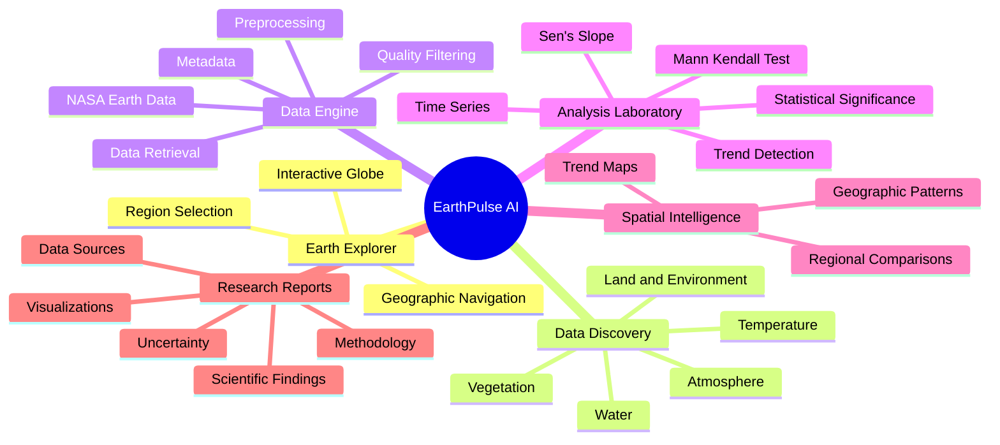
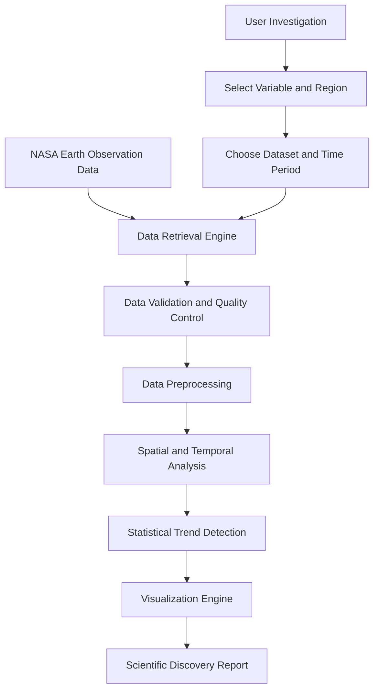

# 🌍 EarthPulse AI

### One Planet. Countless Signals. Discover the Story of Our Changing Earth.

<!-- 🌍 EARTHPULSE IMAGE GALLERY -->

<p align="center">
  
</p>

<h2 align="center">🌍 EXPLORE OUR PLANET</h2>

<p align="center">
  <i>One Planet. Countless Signals. Discover the Story of Our Changing Earth.</i>
</p>

<p align="center">
  
  
</p>

<p align="center">
  
  
</p>

<h2 align="center">🛰️ EARTH OBSERVATION & SCIENTIFIC DISCOVERY</h2>

<p align="center">
  <b>WHAT is changing?</b> &nbsp; • &nbsp;
  <b>WHERE is it changing?</b><br/>
  <b>HOW MUCH is it changing?</b> &nbsp; • &nbsp;
  <b>IS IT SIGNIFICANT?</b>
</p>

---


## 🖥️ EARTHPULSE APPLICATION PREVIEW

<p align="center">
  
  <br/>
  <b>01 — EarthPulse Landing Page</b>
</p>

---

<p align="center">
  
  <br/>
  <b>02 — Interactive Earth Explorer</b>
</p>

---

<p align="center">
  
  <br/>
  <b>03 — Earth Data Discovery</b>
</p>

---

<p align="center">
  
  <br/>
  <b>04 — Scientific Analysis Laboratory</b>
</p>

---

<p align="center">
  
  <br/>
  <b>05 — Scientific Discovery Reports</b>
</p>

---

<p align="center">
  <i>Explore. Investigate. Analyse. Discover. 🌍</i>
</p>
## 🌎 About EarthPulse

EarthPulse is a scientific investigation platform designed to help users explore how Earth's systems are changing over time using satellite observations, environmental datasets, and statistical analysis.

From rising land surface temperatures to changing vegetation patterns, rainfall variations, and environmental shifts, EarthPulse aims to transform complex Earth observation data into understandable, evidence-based discoveries.

Instead of simply displaying environmental data, EarthPulse focuses on answering four important scientific questions:

| Question                    | What EarthPulse investigates                       |
| --------------------------- | -------------------------------------------------- |
| 🔍 WHAT is changing?        | Identify environmental variables and trends.       |
| 📍 WHERE is it changing?    | Locate geographical regions experiencing change.   |
| 📈 HOW MUCH is it changing? | Estimate the magnitude and direction of change.    |
| 🧪 IS IT SIGNIFICANT?       | Evaluate statistical significance and uncertainty. |

**Our vision:** Make Earth science exploration more accessible, interactive, and evidence-driven.

---

## ✨ Project Vision

Imagine selecting any region on Earth, choosing an environmental variable, exploring historical satellite observations, and discovering how that region has changed over time.

EarthPulse aims to make this possible through an integrated scientific workflow:

- Explore Earth through an interactive globe.
- Discover available Earth observation datasets.
- Select variables, geographical regions, and time periods.
- Process and analyse actual scientific observations.
- Visualize temporal and spatial changes.
- Generate evidence-backed research reports.

---

## 🧠 EarthPulse Mind Map



---

## 🛰️ System Architecture

EarthPulse is designed around a scientific data-processing pipeline.



### Scientific Data Workflow

1. **Data acquisition:** Retrieve observations from verified Earth science sources.
2. **Validation:** Inspect metadata, quality flags, missing observations, and units.
3. **Preprocessing:** Apply scale factors, quality filtering, and appropriate aggregation.
4. **Analysis:** Investigate temporal and spatial patterns.
5. **Statistical testing:** Estimate trends and evaluate statistical significance.
6. **Visualization:** Present results through maps, graphs, and interactive exploration.
7. **Reporting:** Communicate findings with sources, methodology, and limitations.

---

## 🖥️ Platform Preview

> Add your actual application screenshots to the `docs/images/` folder and replace these placeholders with the corresponding image links.

### 01. EarthPulse Landing Page

*An immersive entry point to explore our changing planet.*


### 02. Interactive Earth Explorer

*Explore geographical regions and investigate environmental patterns.*


### 03. Data Discovery

*Discover environmental variables and available Earth observation datasets.*


### 04. Analysis Laboratory

*Explore time-series visualizations and statistical analysis.*


### 05. Scientific Discovery Reports

*Present evidence-backed findings, visualizations, and research methodology.*


---

## 🌡️ Environmental Variables

EarthPulse is designed to support multiple categories of Earth system observations.

| Category    | Variables                | Example data sources |
| ----------- | ------------------------ | -------------------- |
| Temperature | Land Surface Temperature | MODIS                |
| Vegetation  | NDVI, EVI                | MODIS                |
| Water       | Precipitation            | GPM IMERG            |
| Soil        | Soil Moisture            | NASA SMAP            |
| Atmosphere  | Aerosol Optical Depth    | MODIS                |
| Land        | Land Cover               | MODIS                |

Dataset availability, temporal coverage, spatial resolution, and supported analysis depend on the selected source.

---

## 📊 Scientific Analysis

EarthPulse aims to go beyond simple averages and basic charts.

### Temporal Analysis

- Historical time-series visualization.
- Seasonal and annual comparisons.
- Long-term trend estimation.
- Missing-data assessment.

### Statistical Methods

- Linear regression.
- Sen's slope estimator.
- Mann–Kendall trend test.
- Confidence intervals.
- P-values and significance assessment.

### Spatial Analysis

- Geographical trend visualization.
- Regional comparisons.
- Identification of spatial patterns.
- Mapping of trend magnitude and direction.

**Scientific integrity matters:** Statistical significance does not automatically mean practical importance. Correlation does not establish causation. Land surface temperature must not be confused with near-surface air temperature.

---

## 🛠️ Technology Stack

The project architecture is designed around the following technologies. Actual implementation may evolve as development progresses.

| Layer                 | Technologies                |
| --------------------- | --------------------------- |
| Frontend              | React, TypeScript           |
| Styling               | Tailwind CSS                |
| Backend               | Node.js, Python / FastAPI   |
| Data Processing       | Pandas, NumPy, Xarray       |
| Scientific Analysis   | SciPy, Statsmodels          |
| Geospatial Processing | Rasterio, GeoPandas         |
| Visualization         | Plotly, MapLibre / Three.js |
| Data Sources          | NASA Earthdata              |

---

## 🗂️ Project Structure

```text
EarthPulse-Ai/
│
├── public/
│
├── src/
│   ├── components/
│   ├── pages/
│   ├── services/
│   ├── hooks/
│   ├── assets/
│   └── ...
│
├── server/
│   ├── routes/
│   ├── services/
│   └── ...
│
├── docs/
│   └── images/
│
├── server.ts
├── index.html
├── package.json
├── vite.config.ts
├── tsconfig.json
├── .env.example
├── .gitignore
└── README.md
```

*The exact folder structure may differ depending on the current implementation.*

---

## 🚀 Getting Started

### Prerequisites

Make sure you have installed:

- Node.js
- npm
- Git
- Visual Studio Code (recommended)

### 1. Clone the Repository

```bash
git clone https://github.com/priyankasunagar/EarthPulse-Ai.git
```

### 2. Navigate to the Project

```bash
cd EarthPulse-Ai
```

### 3. Install Dependencies

```bash
npm install --legacy-peer-deps
```

### 4. Configure Environment Variables

Create a `.env` file using `.env.example` as a reference.

Add the required configuration values for the services you have actually integrated.

**Never upload API keys, credentials, or private tokens to GitHub.**

### 5. Run the Application

```bash
npm run dev
```

Open the local URL printed in your terminal. In the current server configuration, this may be:

```text
http://localhost:3000
```

---

## 🛰️ NASA and Earth Science Data

Potential data sources for EarthPulse include:

- [NASA Earthdata](https://www.earthdata.nasa.gov/)
- [NASA MODIS](https://modis.gsfc.nasa.gov/)
- [NASA GPM](https://gpm.nasa.gov/)
- [NASA SMAP](https://smap.jpl.nasa.gov/)
- [NASA AppEEARS](https://appeears.earthdatacloud.nasa.gov/)

All scientific findings should retain source attribution, observation dates, units, processing methodology, and relevant quality information.

---

## 🗺️ Development Roadmap

- [x] Project concept and scientific investigation workflow.
- [x] Initial application code generated.
- [x] GitHub repository initialized.
- [x] Verify frontend and backend execution.
- [ ] Complete interactive Earth Explorer.
- [ ] Implement NASA data retrieval.
- [ ] Validate and preprocess satellite observations.
- [ ] Implement statistical trend analysis.
- [ ] Build spatial trend visualizations.
- [ ] Generate evidence-backed research reports.
- [ ] Expand supported environmental variables.

---

## 🎯 Why EarthPulse?

Earth is constantly changing, but understanding those changes requires more than raw satellite data.

EarthPulse aims to bridge the gap between complex Earth observation datasets and meaningful scientific discoveries.

By combining Earth science, data engineering, geospatial intelligence, statistical methods, and interactive visualization, the platform seeks to make environmental investigation more accessible and insightful.

**Explore. Investigate. Analyse. Discover.**

---

## 👩‍💻 Project

**Project:** EarthPulse AI
**Domain:** Earth Observation | Data Science | Environmental Intelligence
**Challenge:** NASA Space Apps Challenge 2026 – Be An Earth System Trend Detective!

**Developer:** Priyanka Sunagar

**GitHub Repository:**
[https://github.com/priyankasunagar/EarthPulse-Ai](https://github.com/priyankasunagar/EarthPulse-Ai)

---

\<p align="center">
&#x20; 🌍 \<b>One Planet. Countless Signals.\</b>\<br/>
&#x20; Discover the Story of Our Changing Earth.
\</p>
